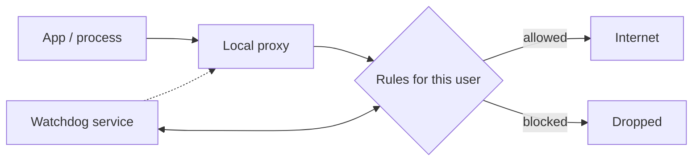
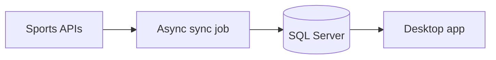

<!--
  SETUP
  - Replace USERNAME, YOUR_EMAIL, YOUR_LINKEDIN, YOUR_UPWORK_URL
  - Replace REPO_1 / REPO_2 with repos you want shown (or delete that section)
  - Search for "ADD:" below. Each one is a spot where one real detail from
    you (a number, a story, a mistake you fixed) will make this read like you.
-->

 

Hi, I'm Harmander. I've been working with C# and .NET for about nine years, building and maintaining web applications, desktop apps, background services, and backends using SQL Server and other databases.

I like software that's easy to maintain and fast where it matters. I'd rather ship something simple that works than something clever that nobody wants to touch. <!-- ADD: one sentence about what you actually enjoy or what you're like to work with. -->

I'm open to remote roles and freelance projects. If you've got something that needs a careful .NET developer, [email me](mailto:singhharmander8@gmail.com).

 

## What I work with

- **Languages:** C#, T-SQL
- **Backend:** ASP.NET Core, REST APIs, Entity Framework Core, third-party API integrations
- **Desktop:** WPF, WinForms
- **Windows internals:** Windows Services, local proxies, system-level tools
- **Data:** SQL Server schema design and query tuning
- **Lately:** adding AI models to desktop tools

 

## Things I've built

<b>Internet access control for Windows</b>

 

A Windows internet filter with per-user rules. Traffic goes through a local proxy, and only whitelisted apps are allowed online. A Windows service watches the proxy and restarts it if it dies. It's running in production.

<!-- ADD: the hardest part of this project, in one or two sentences. E.g. a bug that only showed up in production, or how you handled apps that bypass the proxy. -->

<b>Football analytics desktop app</b>

 

A desktop app that pulls match data from external sports APIs into SQL Server and lets you dig through it. I spent most of the effort on the database: a normalized schema with proper indexes, so queries stay quick as the history grows, and the UI doesn't freeze while they run.

<!-- ADD: a real number. E.g. how many rows, or how much faster a slow query got after you fixed it. -->

<b>AI response assistant</b>

 

A small desktop tool that drafts business replies using AI models. The calls are async, so the window stays responsive while the answer streams in. I built it for my own daily use first, which is why it's quick and has very few buttons.

<!-- ADD: who uses it, or what it saved you. One honest line is enough. -->

 

## Activity

<picture>
  <source media="(prefers-color-scheme: dark)" srcset="https://raw.githubusercontent.com/harmander-singh/harmander-singh/output/github-snake-dark.svg" />
  <source media="(prefers-color-scheme: light)" srcset="https://raw.githubusercontent.com/harmander-singh/harmander-singh/output/github-snake.svg" />
  
</picture>

 

## Get in touch

I'm looking for long-term remote roles (senior C# / .NET, backend, or desktop) and freelance projects like custom systems, APIs, and SQL performance work. Startups are welcome too.

  

